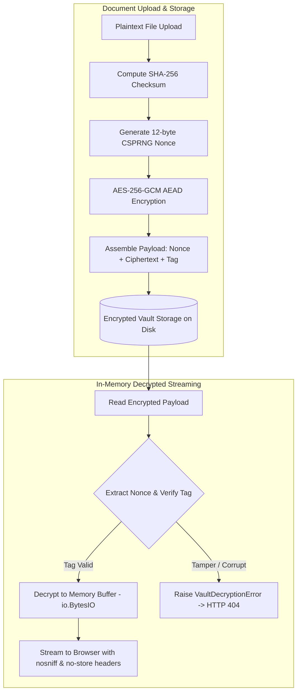

# Passli — Cryptographic Document Vault & Ephemeral Sharing Platform

[](https://github.com/alinawazcode/passli/actions/workflows/ci.yml)
[](https://www.python.org/)
[](https://www.djangoproject.com/)
[](SECURITY.md)
[](LICENSE)

**Passli** is an enterprise-grade, privacy-first personal records vault and ephemeral cryptographic sharing platform. It enables individuals and organizations to securely store sensitive documents with **AES-256-GCM authenticated encryption at rest** and share them with verified recipients via time-gated **Share Passes**—without exposing master cloud credentials, unencrypted email attachments, or cascading folder permissions.

---

## 🔒 The Problem Passli Solves

When sharing sensitive records with doctors, employers, financial institutions, or rental agencies, users are traditionally forced to:
1. **Send raw email attachments** that persist indefinitely across third-party mail relays and recipient local storage.
2. **Share master cloud storage links** (Google Drive, Dropbox, iCloud), risking permanent access leakage and folder cascading.
3. **Hand over unlocked physical devices** to unverified third parties during identity or credential inspections.

**Passli replaces these vulnerabilities with time-gated, cryptographic Share Passes.** You select specific records, define an expiration window (15m, 30m, 1h, 2h, 24h, or single-use view), set download or view-only constraints, and generate an isolated QR code with an 8-character Share Key. When the session expires or is revoked by the owner, recipient access is severed immediately.

---

## ✨ Core Platform Capabilities

### 🗄️ 1. Personal Document Vault
- **Domain Taxonomy**: Organize records into structured categories (`Medical`, `Education`, `Vehicle`, `Personal & Identity`, `Professional`, `Other`).
- **Storage Migration CLI**: Includes `python manage.py encrypt_vault_storage` for seamless batch migration of legacy storage records.

### 🔑 2. Cryptographic Share Passes & Ephemeral QR Protocol
- **Hashed Key Storage**: Plaintext 8-character Share Keys (`XXXX-XXXX`) are never persisted in the database; only salted **PBKDF2-HMAC-SHA256** hashes are retained.
- **Two-Factor Access Guard**: Access requires scanning the isolated session URL **plus** entering the valid Share Key.
- **Granular Permissions**: Restrict recipients to in-browser viewing only or grant file download permissions.
- **Server-Enforced Expirations**: Server-side session termination on timer expiry (15 min to 24 hrs) or burn-after-reading 1-time access.
- **Immediate 1-Click Revocation**: Instantly terminate any active pass and sever recipient sessions in real-time.

### 📱 3. Responsive Recipient Portal
- **Mobile-First Experience**: Optimized for smartphones scanning QR codes, with swipeable document selector chips and touch-friendly viewers.
- **Session Countdown Timer**: Real-time ticker notifying recipients of remaining access duration.
- **Memory Wipe on Exit**: Explicit session termination button clearing in-browser decrypted session references.

### 📧 4. Transactional Email Integration & Security Alerts
- **Email Verification**: User registration protected by time-gated 6-digit numeric OTP codes.
- **Secure Password Reset**: One-time cryptographic token links powered by Django's `PasswordResetTokenGenerator`.
- **Automated Security Notifications**:
  - Immediate password reset confirmation emails.
  - Welcome and onboarding guidance upon account activation.
  - Brute-force QR passcode alerts triggered after 5 consecutive failed verification attempts.
- **SMTP Connectivity Diagnostic**: Built-in CLI command `python manage.py test_smtp [recipient]` to verify Gmail / SMTP connectivity and authentication.

### 🛡️ 5. Security & Audit Threat Feed
- **Structured Audit Logging**: Structured access trail recording IP addresses, user agents, verification successes, failed attempts, and brute-force lockouts.
- **Database-Backed Rate-Limiting & Lockouts**: Persistent tracking per pass and IP address inside atomic transactions with select_for_update(). Enforces a 1-minute lockout after 5 consecutive failures, doubling up to 24 hours on subsequent failures, and returns HTTP 429 with Retry-After.

### ⚡ 6. Custom Platform Administration Console
- **System Telemetry & Storage Analytics**: Real-time storage consumption (MB/GB), category breakdown bars, and active pass monitors at `/admin-dashboard/`.
- **User Governance**: Searchable user management directory with quota inspection, account activation toggles, and staff role promotions.
- **Global File Inventory**: Platform-wide vault explorer with SHA-256 hash inspection, encryption status verification, and physical disk file cleanup.
- **Emergency Pass Governance**: System-wide pass monitor with instant emergency revocation capabilities.

---

## 🔐 Cryptographic Architecture Flow



---

## 📊 Security Architecture Comparison

| Specification | Passli Share Pass | Cloud Shared Folders | Email Attachments |
| :--- | :--- | :--- | :--- |
| **Encryption Standard** | Client-isolated AES-256 + PBKDF2 key hashing | Server-side at rest only | Unencrypted MIME transit |
| **Credential Exposure** | **Zero exposure** (Ephemeral session) | Exposes folder trees & account metadata | Permanent static copies on recipient host |
| **Session Expiration** | **Strict server-enforced timer** | Manual disabling; indefinite persistence | Impossible; persists forever in inboxes |
| **Granular Access** | **Itemized per-pass document bundling** | All-or-nothing folder cascades | Detached static payloads |
| **Audit Visibility** | **Real-time structured access logs & IP feed** | Basic access history (Enterprise only) | Zero visibility after send |

---

## 🏗️ Project Architecture

```text
passli/
├── accounts/                  # User authentication, profiles, superadmin governance & telemetry
│   ├── admin_views.py         # Custom Platform Admin Console views & metric aggregations
│   ├── admin_urls.py          # Admin dashboard routing (/admin-dashboard/)
│   ├── emails.py              # Transactional email service (OTP, password reset, security alerts)
│   ├── management/commands/   # Accounts management commands (ensure_superadmin, test_smtp)
│   ├── models.py              # User profiles, email verification OTP models
│   └── views.py               # Signin, registration, OTP verify, password reset views
├── documents/                 # Document vault, AES-256-GCM encryption models, categorization
│   ├── management/commands/   # Storage migration commands (encrypt_vault_storage)
│   ├── models.py              # Document model with AES-256-GCM lifecycle & SHA-256 digests
│   ├── services/
│   │   └── crypto_service.py  # AES-256-GCM AEAD encryption/decryption primitives & key management
│   └── views.py               # In-memory decrypted preview & download streams
├── sharing/                   # Share Pass generation, cryptographic verification & recipient portal
│   ├── models.py              # SharePass model with salted PBKDF2 hash validation
│   ├── recipient_views.py     # Public recipient authentication & in-memory decrypted stream portal
│   ├── recipient_urls.py      # Recipient endpoint routing (/p/<pass_id>/)
│   └── utils.py               # QR code generator & 8-character Share Key generator
├── audit/                     # Structured security event logging & immutable audit trail
│   ├── models.py              # ShareAccessLog model & log_share_event utility
│   └── views.py               # User audit history feed & filtering
├── config/                    # Django settings, WSGI/ASGI handlers, global URL configuration
├── templates/                 # Semantic HTML5 templates (Vanilla CSS & Material Symbols)
│   ├── administration/        # Custom Admin Console templates (overview, users, documents, passes)
│   ├── documents/             # Vault list, upload, detail, edit, delete templates
│   ├── emails/                # HTML & plaintext email templates (OTP, reset, alert, welcome)
│   ├── sharing/               # Recipient verify, portal, and create templates
│   └── base.html              # Master responsive layout with glassmorphic navbar
├── static/                    # Front-end design assets
│   ├── css/styles.css         # Human-crafted Vanilla CSS custom properties & design tokens
│   ├── js/main.js             # Client-side micro-interactions & token generators
│   └── img/                   # Brand vector logos and favicon assets
├── tests/                     # Automated test suites
│   ├── unit/                  # Comprehensive unit tests
│   │   ├── test_vault_encryption.py    # AES-256-GCM crypto, AAD, tamper, & streaming tests
│   │   ├── test_recipient_lockout.py   # Rate-limiting, brute-force & exponential backoff tests
│   │   ├── test_security_claims.py     # Architectural transparency & security claim validation
│   │   ├── test_email_integration.py   # OTP, password reset, and security alert tests
│   │   ├── test_documents.py           # Document vault CRUD & IDOR tests
│   │   ├── test_recipient_portal.py    # Recipient verification & streaming tests
│   │   ├── test_sharing.py             # Share Pass lifecycle tests
│   │   ├── test_security.py            # Security headers, rate-limiting, and CSRF tests
│   │   ├── test_accounts.py            # User auth & profile tests
│   │   ├── test_administration.py      # Admin Console governance tests
│   │   ├── test_audit.py               # Audit trail & logging tests
│   │   └── test_landing.py             # Public landing page tests
│   └── selenium/                       # Django test client end-to-end user journey suite
├── selenium_presentation_suite/        # Standalone Selenium 4 presentation test framework
│   ├── main.py                         # Test runner & Tkinter dashboard entry point
│   ├── dashboard.py                    # Live Desktop Tkinter PASS/FAIL visual dashboard
│   ├── test_runner.py                  # Multi-threaded test runner & report engine
│   ├── driver_factory.py               # Persistent Chrome WebDriver session manager
│   ├── test_config.py                  # Selectors, timeouts, and credentials configuration
│   ├── tests/                          # 16 full-lifecycle tests + 3 controlled negative demos
│   └── reports/                        # Standalone dark-mode HTML reports & screenshots
├── .github/workflows/ci.yml   # Multi-stage CI pipeline (Ruff, pip-audit, Docker, Postgres, Coverage)
├── Dockerfile                 # Multi-stage production container image with unprivileged appuser
└── manage.py                  # Django CLI management entry point
```

---

## 🚀 Quick Start & Installation

### 1. Prerequisites
- **Python**: 3.11 or 3.12
- **Git**
- **pip** and **virtualenv**

### 2. Clone the Repository
```bash
git clone https://github.com/alinawazcode/passli.git
cd passli
```

### 3. Setup Virtual Environment
```bash
# Windows (PowerShell)
python -m venv .venv
.\.venv\Scripts\Activate.ps1

# Linux / macOS
python3 -m venv .venv
source .venv/bin/activate
```

### 4. Install Dependencies
```bash
# Production dependencies
pip install -r requirements.txt

# For local development and testing
pip install -r requirements-dev.txt
```

### 5. Configure Environment Variables
```bash
# Copy sample environment configuration
cp .env.example .env
```

Key `.env` configuration options:
```env
DEBUG=False
SECRET_KEY=replace-with-a-secure-random-key-in-production

# Vault Master Encryption Key (32-byte hex string)
# Optional in development (derived automatically from SECRET_KEY via HKDF-SHA256 if unset)
# Generate with: python -c "import secrets; print(secrets.token_hex(32))"
VAULT_MASTER_KEY=

# Cryptographic Key Rotation (Optional)
VAULT_MASTER_KEY_PREVIOUS=
VAULT_KEY_VERSION=1

# Reverse Proxy Trusted Hop Count (Default: 1)
TRUSTED_PROXY_COUNT=1

# Initial Superadmin Configuration (for ensure_superadmin command)
DJANGO_SUPERUSER_USERNAME=admin
DJANGO_SUPERUSER_PASSWORD=replace-with-a-strong-admin-password
DJANGO_SUPERUSER_EMAIL=admin@passli.dev

# Optional Secondary Superadmin Configuration (for co-author / co-maintainer)
DJANGO_SECONDARY_SUPERUSER_USERNAME=
DJANGO_SECONDARY_SUPERUSER_PASSWORD=
DJANGO_SECONDARY_SUPERUSER_EMAIL=

# Host & Origin Whitelisting
ALLOWED_HOSTS=localhost,127.0.0.1,yourusername.pythonanywhere.com
CSRF_TRUSTED_ORIGINS=https://yourusername.pythonanywhere.com
APP_URL=https://yourusername.pythonanywhere.com

# Gmail SMTP Email Integration
SMTP_HOST=smtp.gmail.com
SMTP_PORT=465
SMTP_SECURE=true
SMTP_USER=your-email@gmail.com
SMTP_PASS=replace-with-your-16-char-google-app-password
EMAIL_FROM=your-email@gmail.com
```

### 6. Database Migrations & Initial Superuser
```bash
python manage.py migrate
python manage.py ensure_superadmin
python manage.py collectstatic --no-input
```

### 7. Run Local Development Server
```bash
python manage.py runserver
```
Navigate to `http://localhost:8000/` in your browser.

---

## 🛠️ Management CLI Commands

Passli includes specialized Django management commands for operational administration:

| Command | Description | Example Usage |
| :--- | :--- | :--- |
| `encrypt_vault_storage` | Migrates unencrypted legacy files to AES-256-GCM authenticated ciphertext at rest, or re-encrypts existing files to bind UUID AAD and rotate keys. | `python manage.py encrypt_vault_storage --dry-run`<br>`python manage.py encrypt_vault_storage --batch-size 100`<br>`python manage.py encrypt_vault_storage --reencrypt-legacy`<br>`python manage.py encrypt_vault_storage --force` |
| `test_smtp` | Diagnoses SMTP credentials, connection negotiation, SSL/TLS, and dispatches a test message. | `python manage.py test_smtp recipient@example.com` |
| `ensure_superadmin` | Idempotently creates or updates system superadmin accounts from environment variables without password resets. | `python manage.py ensure_superadmin` |

---

## 🧪 Automated Testing & Coverage

Passli enforces strict automated test verification across all platform features.

### 1. Django Test Suite & Coverage Analysis
```bash
# Run the complete unit test suite
python manage.py test tests.unit

# Run dedicated vault encryption tests (crypto, AAD, tamper, streaming, migration)
python manage.py test tests.unit.test_vault_encryption

# Run lockout and rate-limiting tests
python manage.py test tests.unit.test_recipient_lockout

# Run email integration tests (OTP verification, password reset, security alerts)
python manage.py test tests.unit.test_email_integration

# Run specific domain test suites
python manage.py test tests.unit.test_documents
python manage.py test tests.unit.test_sharing
python manage.py test tests.unit.test_recipient_portal
python manage.py test tests.unit.test_security
python manage.py test tests.selenium

# Execute full test suite with code coverage analysis
coverage run --source=accounts,audit,config,documents,sharing manage.py test tests.unit tests.selenium
coverage report --fail-under=80
```

### 2. Standalone Selenium 4 Presentation Test Suite & Desktop GUI
Passli includes an interactive desktop presentation testing suite (`selenium_presentation_suite/`) with a thread-safe Tkinter dashboard engineered for live university and evaluator demonstrations:

```powershell
# Launch the live desktop Tkinter testing dashboard (browser stays open continuously):
python selenium_presentation_suite/main.py

# Or execute full 16-test suite directly via CLI with customizable step delays:
python selenium_presentation_suite/main.py --cli --suite full --delay 2.0

# Run after-login authenticated features only:
python selenium_presentation_suite/main.py --cli --suite auth --delay 2.0

# Run an individual test case (e.g. TC13 Vault Documents):
python selenium_presentation_suite/main.py --test TC13 --delay 2.0

# Run in headless mode:
python selenium_presentation_suite/main.py --cli --suite full --headless --close-browser
```
See [selenium_presentation_suite/README.md](selenium_presentation_suite/README.md) and [selenium_presentation_suite/TEST_CASES.md](selenium_presentation_suite/TEST_CASES.md) for full test specifications.

---

## 🐳 Docker Local Execution

Passli includes an optimized, non-root `Dockerfile` ready for local containerization:

```bash
# Build the Docker image
docker build -t passli .

# Run container with dynamic port binding
docker run -p 8000:8000 -e SECRET_KEY="local-docker-secret-key-12345" -e DEBUG=True passli
```

---

## 🗺️ Application Route Reference

| URL Path | View Handler | Access Level | Description |
| :--- | :--- | :--- | :--- |
| `/` | `landing_view` | Public | Interactive public landing page with simulator |
| `/register/` | `register_view` | Public | User account registration |
| `/verify-email/` | `verify_email_view` | Authenticated | 6-digit numeric OTP email verification |
| `/login/` | `CustomLoginView` | Public | Secure user authentication |
| `/logout/` | `CustomLogoutView` | Authenticated | CSRF-protected session teardown |
| `/password-reset/` | `password_reset_request_view` | Public | Password recovery request form |
| `/password-reset/confirm/<token>/` | `password_reset_confirm_view` | Public | Cryptographic one-time reset token confirm |
| `/dashboard/` | `dashboard_view` | Authenticated | User vault overview and quick actions |
| `/documents/` | `documents_list_view` | Authenticated | Filterable encrypted document vault |
| `/documents/upload/` | `documents_upload_view` | Authenticated | AES-256 upload dropzone and metadata |
| `/documents/<id>/preview/` | `document_preview_view` | Authenticated | In-memory decrypted preview stream |
| `/documents/<id>/download/` | `document_download_view` | Authenticated | In-memory decrypted file download |
| `/documents/<id>/edit/` | `document_edit_view` | Authenticated | Document title/category metadata update |
| `/documents/<id>/delete/` | `document_delete_view` | Authenticated | Document and encrypted disk file removal |
| `/share/` | `share_list_view` | Authenticated | Active and expired share passes list |
| `/share/create/` | `share_create_view` | Authenticated | Ephemeral pass generator with TTL selection |
| `/share/<uuid>/` | `share_detail_view` | Authenticated | Pass telemetry, QR code display, & key |
| `/share/<uuid>/revoke/` | `share_revoke_view` | Authenticated | 1-click immediate pass revocation |
| `/share/<uuid>/qr/download/` | `share_qr_download_view` | Authenticated | Isolated QR code image download |
| `/p/<uuid>/` | `recipient_verify_view` | Public / Rate-limited | Recipient 8-char Share Key gateway |
| `/p/<uuid>/portal/` | `recipient_portal_view` | Verified Recipient | Recipient document viewer & countdown timer |
| `/p/<uuid>/doc/<id>/preview/` | `recipient_doc_preview_view`| Verified Recipient | In-memory decrypted stream for recipient |
| `/p/<uuid>/doc/<id>/download/`| `recipient_doc_download_view`| Verified Recipient | Decrypted file download (if permitted) |
| `/p/<uuid>/leave/` | `recipient_leave_view` | Verified Recipient | Recipient session exit & token purge |
| `/audit/` | `audit_list_view` | Authenticated | Personal cryptographic access audit feed |
| `/admin-dashboard/` | `admin_dashboard_overview` | Superadmin | Platform governance & storage telemetry |
| `/admin-dashboard/users/` | `admin_dashboard_users` | Superadmin | User directory & account activation toggles |
| `/admin-dashboard/documents/`| `admin_dashboard_documents`| Superadmin | Global file repository & SHA-256 digests |
| `/admin-dashboard/passes/` | `admin_dashboard_passes` | Superadmin | Emergency system-wide pass revocation |
| `/admin-dashboard/audit/` | `admin_dashboard_audit` | Superadmin | Global security threat feed & lockout monitor |

---

## 💾 Media Storage & Persistence

By default, uploaded encrypted vault files are stored in `media/` via Django's file storage (configurable via `MEDIA_ROOT`).
On containerized hosts with ephemeral local filesystems (Render, Fly.io):
1. **Persistent Volume**: Attach a persistent volume mounted at the configured `MEDIA_ROOT` directory (`/app/media`) to ensure documents persist across container restarts.
2. **Standard / VPS Hosts**: On PythonAnywhere and traditional VPS instances, disk storage is persistent by default.
3. **Cloud Object Storage (S3 / Cloudflare R2)**: In distributed multi-server environments, configure `django-storages` with an S3-compatible backend.

---

## 🚢 Deployment

Passli can be deployed across multiple environments including **PythonAnywhere**, **Docker**, **Render**, **Fly.io**, or standard Linux VPS servers:

- **PythonAnywhere Deployment**: See the comprehensive step-by-step guide in [docs/DEPLOY_PYTHONANYWHERE.md](docs/DEPLOY_PYTHONANYWHERE.md).
- **General & Docker Deployment**: See [docs/DEPLOYMENT.md](docs/DEPLOYMENT.md).

Before running the server, always apply migrations and collect static assets:
```bash
python manage.py migrate
python manage.py collectstatic --no-input
```
To provision an initial superadministrator account from environment variables, run:
```bash
python manage.py ensure_superadmin
```

### SSL Redirect Troubleshooting
If your deployment experiences an infinite redirect loop (HTTP 301/302 repeatedly redirecting to HTTPS):
1. Set `SECURE_SSL_REDIRECT=False` in your environment variables.
2. Verify whether your host or upstream proxy forwards `X-Forwarded-Proto` with this one-line curl command:
   ```bash
   curl -s -D - https://<your-domain> -o /dev/null | grep -iE "location|http"
   ```
   If the upstream proxy does not send `X-Forwarded-Proto: https`, Django will believe the incoming request is insecure and continuously redirect. Keep `SECURE_SSL_REDIRECT=False` until the proxy is properly configured.

---

## ⚠️ Limitations

Passli is designed with full architectural transparency:
- **Server Holds the Master Key**: Document encryption and decryption occur server-side. Anyone with access to the host environment variables (`VAULT_MASTER_KEY`) can decrypt stored vault records.
- **Not Zero-Knowledge**: Passli uses server-side AES-256-GCM authenticated encryption. There is no client-side encryption.
- **Server-Enforced Access**: Pass expiry and revocation are enforced by application business logic and authentication controls rather than hardware-based cryptographic self-destruction.
- **No Independent Security Audit**: Passli is an independent open-source project and has not undergone third-party cryptographic audits or SOC 2 certification.
- **Free-Hosting Constraints**: When deployed on free tiers like PythonAnywhere Beginner, storage is limited (512 MB total for code, db, and files), outbound traffic is restricted to whitelisted destinations (Gmail SMTP), and web applications require periodic manual confirmation in the dashboard.

---

## 🛡️ Security & Responsible Disclosure

Security and cryptographic isolation are core to Passli. For vulnerability disclosure guidelines, threat models, and cryptographic parameters, please refer to [SECURITY.md](SECURITY.md) or contact **[alinawaz.code@gmail.com](mailto:alinawaz.code@gmail.com)**.

---

## 🤝 Contributing

Contributions, bug reports, and feature proposals are welcome! Please read [CONTRIBUTING.md](CONTRIBUTING.md) and our [CODE_OF_CONDUCT.md](CODE_OF_CONDUCT.md) before opening a pull request.

---

## 📬 Authors & Maintainers

For project inquiries, partnerships, enterprise deployments, or general questions, connect with the project maintainers:

- **Ali Nawaz** — Lead Architecture & Backend Engineering &bull; [@alinawazcode](https://github.com/alinawazcode)
- **Muqadas Fareed** — Co-Author & Project Maintainer &bull; [@Muqadas-Fareed-devt](https://github.com/Muqadas-Fareed-devt)
- **Email Contact**: [alinawaz.code@gmail.com](mailto:alinawaz.code@gmail.com)

---

## 📄 License

This project is open-source and licensed under the [MIT License](LICENSE).
