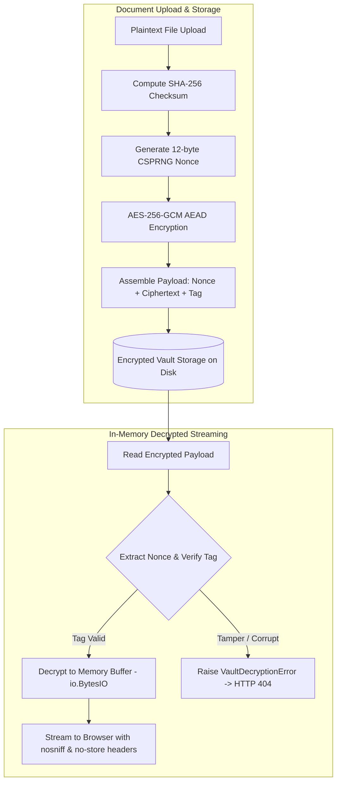

# Passli — Cryptographic Document Vault & Ephemeral Sharing Platform

[](https://www.python.org/)
[](https://www.djangoproject.com/)
[](SECURITY.md)
[](LICENSE)
[](https://railway.com/)

**Passli** is an enterprise-grade, privacy-first personal records vault and ephemeral cryptographic sharing platform. It enables individuals and organizations to securely store sensitive documents with **AES-256-GCM authenticated encryption at rest** and share them with verified recipients via time-gated **Share Passes**—without exposing master cloud credentials, unencrypted email attachments, or cascading folder permissions.

---

## 🔒 The Problem Passli Solves

When sharing sensitive records with doctors, employers, financial institutions, or rental agencies, users are traditionally forced to:
1. **Send raw email attachments** that persist indefinitely across third-party mail relays and recipient local storage.
2. **Share master cloud storage links** (Google Drive, Dropbox, iCloud), risking permanent access leakage and folder cascading.
3. **Hand over unlocked physical devices** to unverified third parties during identity or credential inspections.

**Passli replaces these vulnerabilities with time-gated, cryptographic Share Passes.** You select specific records, define an expiration window (15m, 30m, 1h, 2h, 24h, or single-use view), set download or view-only constraints, and generate an isolated QR code with an 8-character Share Key. When the session expires or is revoked by the owner, recipient access is severed immediately.

---

## ✨ Core Platform Capabilities

### 🗄️ 1. Encrypted Document Vault (AES-256-GCM at Rest)
- **Envelope Encryption**: Uploaded documents are encrypted on ingestion using **AES-256-GCM** with a unique 12-byte CSPRNG nonce per file and a 16-byte Poly1305 authentication tag (`[12-byte Nonce][Ciphertext + 16-byte Tag]`).
- **Binary Digest Integrity**: Pre-encryption **SHA-256** checksums verify data authenticity against original files.
- **In-Memory Decrypted Streaming**: Files are decrypted directly into memory (`io.BytesIO`) during owner previews and downloads—**no plaintext files are ever written to server disk**.
- **Defensive Headers**: Preview and download streams enforce `X-Content-Type-Options: nosniff`, `Cache-Control: no-store, private`, and `Pragma: no-cache`.
- **Domain Taxonomy**: Organize records into structured categories (`Medical`, `Education`, `Vehicle`, `Personal & Identity`, `Professional`, `Other`).
- **Storage Migration CLI**: Includes `python manage.py encrypt_vault_storage` for seamless batch migration of legacy storage records.

### 🔑 2. Cryptographic Share Passes & Ephemeral QR Protocol
- **Hashed Key Storage**: Plaintext 8-character Share Keys (`XXXX-XXXX`) are never persisted in the database; only salted **PBKDF2-HMAC-SHA256** hashes are retained.
- **Two-Factor Access Guard**: Access requires scanning the isolated session URL **plus** entering the valid Share Key.
- **Granular Permissions**: Restrict recipients to in-browser viewing only or grant file download permissions.
- **Server-Enforced Expirations**: Hardware session termination on timer expiry (15 min to 24 hrs) or burn-after-reading single-use access.
- **Immediate 1-Click Revocation**: Instantly terminate any active pass and sever recipient sessions in real-time.

### 📱 3. Responsive Recipient Portal
- **Mobile-First Experience**: Optimized for smartphones scanning QR codes, with swipeable document selector chips and touch-friendly viewers.
- **Session Countdown Timer**: Real-time ticker notifying recipients of remaining access duration.
- **Memory Wipe on Exit**: Explicit session termination button clearing in-browser decrypted session references.

### 📧 4. Transactional Email Integration & Security Alerts
- **Email Verification**: User registration protected by time-gated 6-digit numeric OTP codes.
- **Secure Password Reset**: One-time cryptographic token links powered by Django's `PasswordResetTokenGenerator`.
- **Automated Security Notifications**:
  - Immediate password reset confirmation emails.
  - Welcome and onboarding guidance upon account activation.
  - Brute-force QR passcode alerts triggered after 5 consecutive failed verification attempts.
- **SMTP Connectivity Diagnostic**: Built-in CLI command `python manage.py test_smtp [recipient]` to verify Gmail / SMTP connectivity and authentication.

### 🛡️ 5. Security & Audit Threat Feed
- **Structured Audit Logging**: Structured access trail recording IP addresses, user agents, verification successes, failed attempts, and brute-force lockouts.
- **PII Sanitization**: Sensitive parameters (Share Keys, email addresses, file names) are automatically masked before logging.
- **Rate-Limiting & Lockouts**: Exponential backoff and lockouts protecting share passes against automated brute-force attempts.

### ⚡ 6. Custom Platform Administration Console
- **System Telemetry & Storage Analytics**: Real-time storage consumption (MB/GB), category breakdown bars, and active pass monitors at `/admin-dashboard/`.
- **User Governance**: Searchable user management directory with quota inspection, account activation toggles, and staff role promotions.
- **Global File Inventory**: Platform-wide vault explorer with SHA-256 hash inspection, encryption status verification, and physical disk file cleanup.
- **Emergency Pass Governance**: System-wide pass monitor with instant emergency revocation capabilities.

---

## 🔐 Cryptographic Architecture Flow



---

## 📊 Security Architecture Comparison

| Specification | Passli Share Pass | Cloud Shared Folders | Email Attachments |
| :--- | :--- | :--- | :--- |
| **Vault Storage** | **AES-256-GCM Envelope Encryption at Rest** | Server-side at rest only | Unencrypted MIME transit |
| **Tamper Resistance** | **16-byte Poly1305 / GCM AEAD Tag** | Cloud provider internal | None (MIME easily altered) |
| **Credential Exposure** | **Zero exposure** (Ephemeral session) | Exposes folder trees & account metadata | Permanent static copies on recipient host |
| **Session Expiration** | **Strict server & hardware timer** | Manual disabling; indefinite persistence | Impossible; persists forever in inboxes |
| **Granular Access** | **Itemized per-pass document bundling** | All-or-nothing folder cascades | Detached static payloads |
| **Audit Visibility** | **Real-time structured access logs & IP feed** | Basic access history (Enterprise only) | Zero visibility after send |

---

## 🏗️ Project Architecture

```text
passli/
├── accounts/                  # User authentication, profiles, superadmin governance & telemetry
│   ├── admin_views.py         # Custom Platform Admin Console views & metric aggregations
│   ├── admin_urls.py          # Admin dashboard routing (/admin-dashboard/)
│   ├── emails.py              # Transactional email service (OTP, password reset, security alerts)
│   ├── management/commands/   # Accounts management commands (ensure_superadmin, test_smtp)
│   ├── models.py              # User profiles, email verification OTP models
│   └── views.py               # Signin, registration, OTP verify, password reset views
├── documents/                 # Document vault, AES-256-GCM encryption models, categorization
│   ├── management/commands/   # Storage migration commands (encrypt_vault_storage)
│   ├── models.py              # Document model with AES-256-GCM lifecycle & SHA-256 digests
│   ├── services/
│   │   └── crypto_service.py  # AES-256-GCM AEAD encryption/decryption primitives & key management
│   └── views.py               # In-memory decrypted preview & download streams
├── sharing/                   # Share Pass generation, cryptographic verification & recipient portal
│   ├── models.py              # SharePass model with salted PBKDF2 hash validation
│   ├── recipient_views.py     # Public recipient authentication & in-memory decrypted stream portal
│   ├── recipient_urls.py      # Recipient endpoint routing (/p/<pass_id>/)
│   └── utils.py               # QR code generator & 8-character Share Key generator
├── audit/                     # Structured security event logging & immutable audit trail
│   ├── models.py              # ShareAccessLog model & log_share_event utility
│   └── views.py               # User audit history feed & filtering
├── config/                    # Django settings, WSGI/ASGI handlers, global URL configuration
├── templates/                 # Semantic HTML5 templates (Vanilla CSS & Material Symbols)
│   ├── administration/        # Custom Admin Console templates (overview, users, documents, passes)
│   ├── documents/             # Vault list, upload, detail, edit, delete templates
│   ├── emails/                # HTML & plaintext email templates (OTP, reset, alert, welcome)
│   ├── sharing/               # Recipient verify, portal, and create templates
│   └── base.html              # Master responsive layout with glassmorphic navbar
├── static/                    # Human-crafted Vanilla CSS (styles.css) & client JS (main.js)
├── tests/                     # Comprehensive test suites
│   ├── unit/
│   │   ├── test_vault_encryption.py    # AES-256-GCM crypto, tamper, migration, & streaming tests
│   │   ├── test_email_integration.py   # OTP, password reset, and security alert tests
│   │   ├── test_documents.py           # Document vault CRUD & IDOR tests
│   │   ├── test_recipient_portal.py    # Recipient verification & streaming tests
│   │   ├── test_sharing.py             # Share Pass lifecycle tests
│   │   ├── test_security.py            # Security headers, rate-limiting, and CSRF tests
│   │   ├── test_accounts.py            # User auth & profile tests
│   │   ├── test_administration.py      # Admin Console governance tests
│   │   ├── test_audit.py               # Audit trail & logging tests
│   │   └── test_landing.py             # Public landing page tests
│   └── selenium/                       # Browser end-to-end user journey test suites
├── Procfile                   # Production Gunicorn deployment process
├── railway.json               # Railway PaaS deployment configuration
├── nixpacks.toml              # Nixpacks build pipeline configuration
└── manage.py                  # Django CLI management entry point
```

---

## 🚀 Quick Start & Installation

### 1. Prerequisites
- **Python**: 3.11 or 3.12
- **Git**
- **pip** and **virtualenv**

### 2. Clone the Repository
```bash
git clone https://github.com/alinawazcode/passli.git
cd passli
```

### 3. Setup Virtual Environment
```bash
# Windows (PowerShell)
python -m venv .venv
.\.venv\Scripts\Activate.ps1

# Linux / macOS
python3 -m venv .venv
source .venv/bin/activate
```

### 4. Install Dependencies
```bash
# Production dependencies
pip install -r requirements.txt

# For local development and testing
pip install -r requirements-dev.txt
```

### 5. Configure Environment Variables
```bash
# Copy sample environment configuration
cp .env.example .env
```

Key `.env` configuration options:
```env
DEBUG=False
SECRET_KEY=replace-with-a-secure-random-key-in-production

# Vault Master Encryption Key (32-byte hex string)
# Optional in development (derived automatically from SECRET_KEY via HKDF-SHA256 if unset)
# Generate with: python -c "import secrets; print(secrets.token_hex(32))"
VAULT_MASTER_KEY=

# Initial Superadmin Configuration (for ensure_superadmin command)
DJANGO_SUPERUSER_USERNAME=admin
DJANGO_SUPERUSER_PASSWORD=replace-with-a-strong-admin-password
DJANGO_SUPERUSER_EMAIL=admin@passli.dev

# Host & Origin Whitelisting
ALLOWED_HOSTS=localhost,127.0.0.1,your-app.up.railway.app
CSRF_TRUSTED_ORIGINS=https://your-app.up.railway.app
APP_URL=https://your-app.up.railway.app

# Gmail SMTP Email Integration
SMTP_HOST=smtp.gmail.com
SMTP_PORT=465
SMTP_SECURE=true
SMTP_USER=your-email@gmail.com
SMTP_PASS=replace-with-your-16-char-google-app-password
EMAIL_FROM=your-email@gmail.com
```

### 6. Database Migrations & Initial Superuser
```bash
python manage.py migrate
python manage.py ensure_superadmin
python manage.py collectstatic --no-input
```

### 7. Run Local Development Server
```bash
python manage.py runserver
```
Navigate to `http://localhost:8000/` in your browser.

---

## 🛠️ Management CLI Commands

Passli includes specialized Django management commands for operational administration:

| Command | Description | Example Usage |
| :--- | :--- | :--- |
| `encrypt_vault_storage` | Migrates unencrypted legacy files to AES-256-GCM authenticated ciphertext at rest. | `python manage.py encrypt_vault_storage --dry-run`<br>`python manage.py encrypt_vault_storage --batch-size 100` |
| `test_smtp` | Diagnoses SMTP credentials, connection negotiation, SSL/TLS, and dispatches a test message. | `python manage.py test_smtp recipient@example.com` |
| `ensure_superadmin` | Idempotently creates or updates the system superadmin user based on `.env` settings. | `python manage.py ensure_superadmin` |

---

## 🧪 Automated Testing

Passli enforces strict automated test verification across all platform features.

```bash
# Run the complete unit test suite
python manage.py test tests.unit

# Run dedicated vault encryption tests (crypto, tamper, streaming, migration)
python manage.py test tests.unit.test_vault_encryption

# Run email integration tests (OTP verification, password reset, security alerts)
python manage.py test tests.unit.test_email_integration

# Run specific domain test suites
python manage.py test tests.unit.test_documents
python manage.py test tests.unit.test_sharing
python manage.py test tests.unit.test_recipient_portal
python manage.py test tests.unit.test_security

# Run tests with verbose output
python manage.py test -v 2
```

---

## 💾 Media Storage & Persistence (PaaS / Railway)

By default, uploaded encrypted vault files are stored in `media/` via Django's file storage.
Because PaaS container instances (Railway, Render, Fly.io) have ephemeral local filesystems that reset on container redeployment or restart, **uploaded documents will not survive a redeployment without persistent storage**:

1. **Railway Persistent Volume (Recommended)**:
   - In Railway Project Settings, add a **Volume**.
   - Set the mount path to `/app/media` (or your application's `media/` directory).
   - This ensures uploaded records persist across container restarts and new deployments.
2. **Cloud Object Storage (S3 / Cloudflare R2)**:
   - In production enterprise setups, install `django-storages[boto3]` and configure `DEFAULT_FILE_STORAGE = 'storages.backends.s3boto3.S3Boto3Storage'` pointing to your private S3 or Cloudflare R2 bucket.

---

## 🚢 Deployment (Railway & PaaS)

Passli is production-ready for deployment on **Railway**, **Render**, **Fly.io**, or **Heroku**.

1. Connect your GitHub repository to Railway.
2. Railway detects `railway.json` and `nixpacks.toml` automatically.
3. Assets are compiled during the build phase (`python manage.py collectstatic --no-input`), and the runtime start command executes:
   ```bash
   python manage.py migrate && python manage.py ensure_superadmin && gunicorn config.wsgi:application --bind 0.0.0.0:$PORT
   ```
   > **Multi-Replica Notice**: If scaling to multiple concurrent web container replicas, execute database migrations in a dedicated release phase or one-off task rather than concurrently across starting web containers to avoid migration lock contention.
4. Configure production environment variables in Railway's **Variables** tab:
   - `SECRET_KEY`
   - `VAULT_MASTER_KEY`
   - `ALLOWED_HOSTS`
   - `CSRF_TRUSTED_ORIGINS`
   - `APP_URL`
   - `SMTP_HOST`, `SMTP_PORT`, `SMTP_USER`, `SMTP_PASS`, `SMTP_SECURE`, `EMAIL_FROM`
   - `DEBUG=False`

---

## 🛡️ Security & Responsible Disclosure

Security and cryptographic isolation are core to Passli. For vulnerability disclosure guidelines, threat models, and cryptographic parameters, please refer to [SECURITY.md](SECURITY.md) or contact **[alinawaz.code@gmail.com](mailto:alinawaz.code@gmail.com)**.

---

## 🤝 Contributing

Contributions, bug reports, and feature proposals are welcome! Please read [CONTRIBUTING.md](CONTRIBUTING.md) and our [CODE_OF_CONDUCT.md](CODE_OF_CONDUCT.md) before opening a pull request.

---

## 📬 Authors & Maintainers

For project inquiries, partnerships, enterprise deployments, or general questions, connect with the project maintainers:

- **Ali Nawaz** — Lead Architecture & Backend Engineering &bull; [@alinawazcode](https://github.com/alinawazcode)
- **Muqadas Fareed** — Co-Author & Project Maintainer &bull; [@Muqadas-Fareed-devt](https://github.com/Muqadas-Fareed-devt)
- **Email Contact**: [alinawaz.code@gmail.com](mailto:alinawaz.code@gmail.com)
- **Live Demo**: [https://web-production-c1bd05e.up.railway.app](https://web-production-c1bd05e.up.railway.app)

---

## 📄 License

This project is open-source and licensed under the [MIT License](LICENSE).
