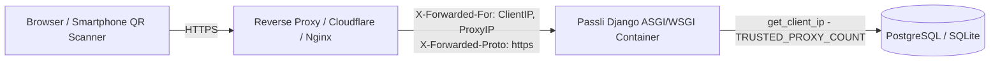

# Passli Cryptographic Architecture & System Design

Passli is a privacy-first, zero-credential-exposure personal document vault and ephemeral sharing platform. This document details the low-level cryptographic engineering, threat modeling, and component architecture.

---

## 1. Cryptographic Primitives & Algorithms

| Domain | Algorithm / Standard | Parameters / Key Size | Purpose |
| :--- | :--- | :--- | :--- |
| **Data Encryption at Rest** | AES-256-GCM (Galois/Counter Mode) | 256-bit key, 96-bit (12-byte) nonce, 128-bit (16-byte) AEAD tag | Authenticated encryption of uploaded documents |
| **Associated Data (AAD)** | UUIDv4 (UTF-8 binary bytes) | 36-byte UUID string encoded to bytes | Cryptographically binds ciphertext to the database record |
| **Ephemeral Key Derivation** | PBKDF2-HMAC-SHA256 | 100,000 iterations, 32-byte salt | Salted one-way hash of 8-character recipient Share Keys |
| **Original File Checksums** | SHA-256 (FIPS 180-4) | 256-bit digest (64 hex characters) | Verification of original plaintext file integrity |
| **Development Key Derivation** | HKDF-SHA256 (RFC 5869) | 256-bit derived key from `SECRET_KEY` | Deterministic local development key when `VAULT_MASTER_KEY` is omitted |

---

## 2. Document Vault Cryptographic Lifecycle

### 2.1 File Ingestion & Storage Wire Format
When a user uploads a document:
1. **Plaintext Hashing**: Original plaintext bytes are read in-memory; a SHA-256 digest is calculated and stored in `Document.file_hash`.
2. **CSPRNG Nonce Generation**: A cryptographically secure 12-byte nonce is generated via `os.urandom(12)`.
3. **AEAD Encryption with AAD**:
   - The plaintext is encrypted using `AESGCM(master_key).encrypt(nonce, plaintext, associated_data=str(document.uuid).encode('utf-8'))`.
   - The resulting payload is: `[12-byte Nonce] + [Ciphertext] + [16-byte GCM Authentication Tag]`.
4. **Physical Write**: The combined encrypted payload is persisted to `media/vault_files/`.
5. **No Plaintext Persistence**: Plaintext never touches disk in an unencrypted state.

### 2.2 In-Memory Decrypted Streaming (Zero Plaintext Disk Writes)
When an authorized user or verified recipient views or downloads a document:
1. The encrypted payload is read from disk into an `io.BytesIO` buffer.
2. The 12-byte nonce is extracted from the first 12 bytes; the remaining bytes contain ciphertext and the 16-byte tag.
3. AES-GCM verifies the tag and decrypts using the record's UUID as AAD.
4. If the tag or ciphertext has been altered, tampered with, or swapped with another document's record, decryption fails immediately with `VaultDecryptionError`, returning `HTTP 404/403` to prevent information leakage.
5. Successful decryption returns an in-memory `io.BytesIO` stream with anti-caching HTTP security headers:
   ```http
   X-Content-Type-Options: nosniff
   Cache-Control: no-store, no-cache, must-revalidate, private
   Pragma: no-cache
   ```

### 2.3 Master Key Rotation
Passli supports zero-downtime key rotation:
- Documents are tagged with `key_version` (default: `1`).
- When rotating keys:
  1. Set `VAULT_MASTER_KEY` to the new 32-byte hex key.
  2. Set `VAULT_MASTER_KEY_PREVIOUS` to the old key.
  3. Set `VAULT_KEY_VERSION` to `2`.
  4. Run `python manage.py encrypt_vault_storage --reencrypt-legacy` to re-encrypt all existing files with the new key and update their `key_version`.

---

## 3. Ephemeral Share Pass Protocol

### 3.1 Plaintext Key Isolation
- Plaintext 8-character keys (`XXXX-XXXX`) use a 31-character unambiguous alphabet (`ABCDEFGHJKMNPQRSTUVWXYZ23456789`, omitting lookalikes `0`, `O`, `1`, `I`, `L`).
- Plaintext keys are **never stored** in the database.
- Only salted **PBKDF2-HMAC-SHA256** password hashes are retained (`django.contrib.auth.hashers.make_password`).

### 3.2 Persistent Database-Backed Lockout & Rate-Limiting
To defend against brute-force attacks on the 8-character key:
1. Recipient key submissions trigger atomic transaction inspection using `select_for_update()`.
2. Failed attempts increment consecutive failure counters per pass and client IP.
3. **Lockout Escalation**:
   - 5 consecutive failures enforce a **1-minute lockout**.
   - Subsequent failures double the lockout duration (exponential backoff up to **24 hours**).
   - Requests during lockout receive `HTTP 429 Too Many Requests` with a calculated `Retry-After` header.
4. On 5 consecutive failed attempts, an automated security notification email is dispatched to the pass owner alerting them of potential brute-force activity.

---

## 4. Reverse Proxy & Network Architecture



- Passli determines client IP through `get_client_ip(request)` which inspects `HTTP_X_FORWARDED_FOR` based on `TRUSTED_PROXY_COUNT`.
- Addresses are validated with Python's standard `ipaddress.ip_address` module before database insertion, guaranteeing strict compatibility with PostgreSQL's native `inet` network type.
